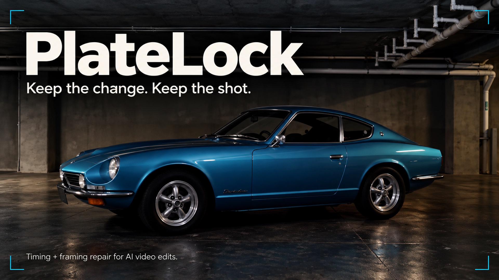

# PlateLock for ComfyUI

**Keep the change. Keep the shot.**

Align AI video edits to their original plate. PlateLock repairs timing mismatches and fixed framing shifts, then lets you compare the result in ComfyUI.

[](docs/media/PlateLock-Demo-1080p.mp4)

[Watch the demo](docs/media/PlateLock-Demo-1080p.mp4) · [Download posters](docs/media/README.md) · [Usage guide](docs/usage.md)

## What it does

- **Timing:** match frames, remove repeats and reconstruct short gaps with RIFE.
- **Framing:** apply one scale and position correction, validated on withheld frames.
- **Review:** compare the plate, AI take and repaired output with synchronized playback, wipes and overlays.

## Install

Requires ComfyUI with native video nodes, plus FFmpeg and ffprobe on your PATH. From the ComfyUI directory, using its Python environment:

```sh
git clone https://github.com/Chapter-41/comfyui-platelock.git custom_nodes/comfyui-platelock
.venv/bin/python -m pip install -r custom_nodes/comfyui-platelock/requirements.txt
.venv/bin/python custom_nodes/comfyui-platelock/tools/check_install.py --comfy-root .
```

For Windows portable, use `../python_embeded/python.exe` from its `ComfyUI` directory. Restart ComfyUI. No API key is required; analysis and framing correction need no model weights. Timing reconstruction requires a compatible RIFE checkpoint in `models/frame_interpolation`.

## Use

Load the original plate and AI take into **PlateLock Studio**. Run **Analyse**, open the review, choose **Correct framing** or **Repair timing**, then run **Repair**. Connect the output to Save Video.

Start with the [example workflows](example_workflows). The [usage guide](docs/usage.md) covers setup, generated test clips and advanced options.

## Scope

Framing repair corrects a fixed scale and translation; it does not remove arbitrary progressive drift or local deformation. Rendering uses 8-bit RGB and omits audio. LTX reconstruction is experimental. The demo's LTX mask/compositing step is a separate finishing workflow.

[Validation and limitations](docs/validation.md) · [Demo sources and credits](docs/media/README.md)

Application code is [MIT licensed](LICENSE). Models and demo media retain their respective licenses.
